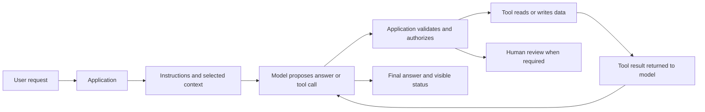

# Lesson 11: how the parts of an AI system fit together

Learning outcome: explain a request from input to final state, and choose a sensible role for a model. Read the worked example before changing the code.

## 1. Model, application and system

A **model** transforms inputs into predictions or generated outputs using learned parameters. An **application** decides what data to supply, how to interpret outputs and which actions to permit. The surrounding **system** includes people, data sources, identity, infrastructure, monitoring and recovery.

An accurate model can be part of an unreliable application if it receives stale data, loses state or executes an unauthorized action. A useful application therefore needs software and operating practices as well as model capability.



The arrows are important: a proposed tool call does not itself execute a function. The application executes permitted code and returns the result. Some systems use a fixed workflow rather than a model-driven loop.

## 2. Where machine learning fits

| Approach | What happens | Small example |
|---|---|---|
| Rules/deterministic code | A person specifies the logic | Reject a missing required invoice field |
| Supervised learning | A model learns from examples with target labels/values | Predict whether a ticket needs specialist review from labeled examples |
| Unsupervised learning | A model finds structure without the same kind of target labels | Group similar documents for exploration |
| Generative model | A model generates text or other content from context | Draft a grounded explanation of a review |

These categories can be combined. They do not imply that every application needs an LLM, an agent or model training. First define the task and a simple baseline.

**Training** adjusts learned parameters using data and an objective. **Inference** uses existing parameters to produce an output. A normal prompt or retrieved document supplies context for inference; it does not ordinarily retrain model weights. Fine-tuning is a separate training procedure. Persistent memory generally comes from saved application data or a service's state, not from assuming the model learned the last conversation permanently.

## 3. Language-model essentials

- **Tokens:** units produced by a tokenizer, often word fragments rather than whole words. Token boundaries and counts vary by model. Character count is not an exact token count.
- **Embeddings:** numeric representations that can place related inputs near one another under a chosen similarity measure. A high similarity score does not prove a claim is true or that the user may access the source.
- **Attention/transformers:** mechanisms used by many language models to compute representations using relationships among token positions. This is not a factual database or an authorization system.
- **Context window:** the bounded material available during a request, including instructions, conversation and tool results as the API represents them. Relevant evidence and its placement matter.
- **Generation:** output depends on model parameters, supplied context and generation settings. Results can vary. Repetition or a confident tone does not establish correctness.

The probability of a next token, a model's verbal confidence and an extraction service's field-confidence value are different quantities. Assess correctness against evidence and labeled outcomes for your actual task.

For deeper architecture and training study, use [the Hugging Face LLM course](https://huggingface.co/learn/llm-course/en/chapter1/1). This guide concentrates on application engineering.

## 4. Four ways to improve an application

| Need | First approach to investigate | What it changes |
|---|---|---|
| Instructions or output requirements are unclear | Better specification, prompt, examples and validation | What the model is asked to do and what outputs are accepted |
| The answer needs current/private source material | Retrieval plus source/version/access controls | Evidence supplied at inference time |
| A task needs data access, computation or a state change | Narrow application tools | Permitted external capabilities |
| A repeatable behavior still needs adaptation with adequate examples | Consider fine-tuning after baseline evaluation | Model parameters through training |

Fine-tuning is not the first repair for missing fresh source data or bad access controls. Retrieval is not permission enforcement. A prompt asking for JSON does not replace schema validation; tool support and structured-output features depend on the actual model/API.

## 5. Retrieval explained as a pipeline

One common path is: ingest documents -> parse -> divide into chunks -> attach metadata -> index -> retrieve candidates -> optionally rerank -> assemble context -> generate -> check source support. Refresh and deletion must propagate through the relevant stores.

Lexical search matches words. Semantic search uses learned representations to find related material even when wording differs. Hybrid search combines signals. The local `search_policy` is deliberately a lexical baseline; it does not calculate embeddings or establish semantic understanding.

Chunk size, overlap, metadata filters and source versions can change results. If a user is not allowed to see a document, filter access before its text reaches the model and check the action/output boundary too. A citation is a pointer to inspect, not automatic proof that the cited text supports the answer.

## 6. Worked trace: a customer lookup

Run from the repository root:

```powershell
python -m examples.ai_systems agent --provider mock --prompt "What is the risk tier for C-1002?"
```

1. `__main__.py` chooses the configured backend, builds the tool context and opens the local state store.
2. The scripted mock proposes `lookup_customer` with customer ID C-1002. A real model would generate a proposal through its own API.
3. `run_agent` passes the proposal to `ToolContext.dispatch` in `core.py`.
4. The dispatcher checks the tool name, argument keys/types and customer-ID format.
5. The lookup reads `customers_clean.csv`, where C-1002 already has the label medium. No risk model is trained or invoked to obtain that label.
6. The result returns through the conversation format and a final response is produced. The trace records the tool and result. A read does not create a review record, though opening a new SQLite database initializes its empty schema.

Now request a review without write authorization. The model/mock may propose a write, but the dispatcher returns `approval_required`. Adding application authorization and a permitted customer allows a pending local record. The human decision remains a separate command.

Read the corresponding functions and point at each boundary. The example's local flags are an instructional permission mechanism; a deployed multi-user system also needs authenticated identities and resource-specific authorization.

## 7. Make a design choice before adding autonomy

For an exact lookup, a direct database query is sufficient. A model may become useful when interpreting varied language, combining evidence or drafting explanations. An agent becomes useful when choosing the next step cannot be adequately handled by a simpler workflow and its behavior can be evaluated.

Start with the smallest design that meets the need. Add complexity only when measured task quality, coverage or usability improves enough to justify cost and failure modes. See [evaluation](12-evaluation-and-experiments.md) for how to make that comparison.

## Check understanding

1. Does adding a policy paragraph to a prompt retrain a model?
2. What can go wrong when the right document is retrieved?
3. Who executes and authorizes a tool call?
4. Is the mock's risk-tier response a learned prediction?

<details><summary>Answer key</summary>

1. Ordinarily no: it changes inference context, not trained parameters.
2. The model may misinterpret it, cite it incorrectly, combine it with stale material or make unsupported claims. Access and output handling can also fail.
3. Application code executes permitted actions; the model only proposes them.
4. No: it reads an assigned fictional value from a CSV.

</details>
